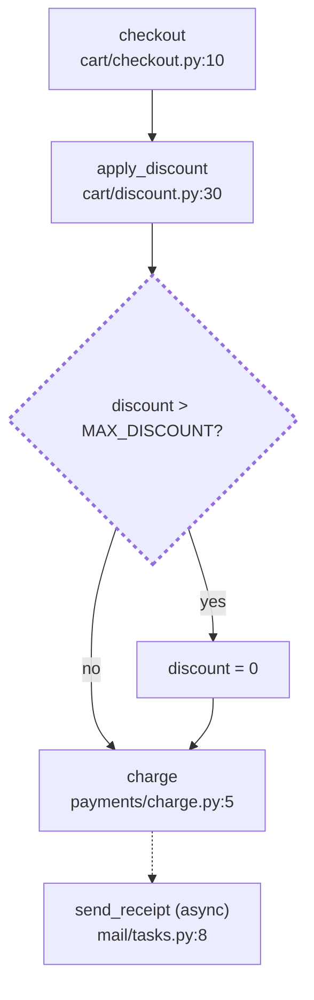

# code-schematic

Shows how one code path works at one git ref: a high-level picture plus the code that makes it. One call writes
one file for one ref. To compare two states, call it twice (section 7).

## 1. Inputs

| Input | Meaning | Default |
|---|---|---|
| `ref` | a sha, branch or tag, or `WORKTREE` for uncommitted files | `HEAD` |
| `label` | `Before`, `After` or none | none |
| entry point | the function, command or file where the path starts | ask; never guess |
| scope | where to stop following calls (a layer, a package, a boundary) | stop at the repo's edge |
| `diff` | a range such as `base..head`, to mark what changed and fold what did not | none |
| output path | where to write the file | `<label lowercased>-schematic.md`, or `schematic.md` without a label, in the caller's folder, else the current directory |

## 2. Read at the ref

Every line ref you write is read at `ref`: `git show "${REF}:path"`, never from the working tree or from memory.
Write `"${REF}:path"`, never `$REF:path`: in zsh, `:h` and `:w` after a variable are modifiers. With
`ref = WORKTREE`, read the working-tree files and say so in the title. Resolve the ref's date with
`git log -1 --format=%cs <ref>` (today for `WORKTREE`). Trace the calls from the entry point, in order, until the
scope ends.

- **Keep every branch that ends the flow.** A schematic that drops the branch the change touches is wrong,
  however tidy it looks.
- **Drop docstrings, logging boilerplate and imports**, except imports that cross packages: those are the
  coupling, so keep them.

## 3. Output, in this order

1. **Title:** `# <label>: <entry point> at <short sha or "working tree">, <date>`, then one line:
   `Line refs point at <ref>.`
2. **`## High-level flow`:** a Mermaid `flowchart TD` of at most 15 nodes.
   - One node per function: `id["name<br/>path:line"]`.
   - Decisions are diamonds: `id{"condition?"}`, with the outcome on each edge.
   - Every outcome that ends the flow (return, error, exit, stop) is its own node. So is an exception that
     escapes to the caller (`raises KeyError → request fails`), and so is each side effect on the way: a
     database write and a call to an outside service.
   - A gate made of chained `and`s, or evaluated inside a filter, is one diamond per input that can refuse, all
     joining the single outcome node the caller tests (`no recipients → return`).
   - Work handed to another process (a queue task, a webhook, an outbox) joins with a dotted edge: `-.->`.
   - With a `diff` that ends at `ref`, mark the touched nodes: `classDef changed stroke-width:3px,stroke-dasharray:4` and
     `class <ids> changed`.
   - More than 15 nodes: first merge the refusing diamonds into one, labelled with their conditions; then
     collapse one layer into a single node, and say which under the chart.
3. **`## Schematic`:** pseudo-code in the repo's language. The caller first, then one block per layer in call
   order. Each block opens with a file banner (`# ── path/to/file ──`), keeps the real names, and ends each line
   it summarises with `# :<line>`. With a `diff` that ends at `ref`, mark lines `# NEW` or `# CHANGED`; otherwise no marks.
   - **No callers yet:** the caller banner reads `# ── caller (none yet; <why>) ──`, followed by one illustrative
     call with the real signature at this ref.
   - **Async hand-off:** work that continues in another process gets its own block after the write that hands
     off to it, with `(async)` in its banner.
   - **Last block:** the settings and config the path reads, with their defaults.
4. **`## Decision table`:** only when a gate has three or more inputs. One column per input, one row per case,
   the outcome last.
5. **`## Levels`:** one line per hop, counting how many names, modules and packages one decision passes through,
   with what each hop reads (a setting, the database, a constant).

## 4. Render check

Prove the chart parses. Write it to a `.mmd` file next to the output and render it once:

```bash
npx -y --registry=https://registry.npmjs.org @mermaid-js/mermaid-cli -i <name>.mmd -o <name>.svg
```

The registry flag stops a repo `.npmrc` that points at a private feed from failing with E401. A parse error
exits non-zero: fix the chart and render again. No `npx` or no network: write `Chart not render-checked: <why>.`
under the chart instead.

## 5. Small diffs

When the `diff` changes 20 lines or fewer and adds or removes no function on the path, the output contract still
applies, reduced:

- **Pass the `diff` to both calls.** The Before file uses it only to decide what to fold.
- **Schematic:** a layer the diff does not touch keeps its banner and its signature line, then
  `...  # unchanged` (a whole layer needs no range). Write out the changed layers, and the caller folded the
  same way.
- **Inside a changed layer,** keep the changed lines (at this ref), the decision each sits in and the line that ends the flow;
  fold each run of untouched lines into one `...  # unchanged :<from>-<to>`. A path in a single file folds the
  same way.
- **Levels:** in the second call, `Unchanged from <first file>.`
- **Second call:** re-read only the changed files at the head ref.
- **The render check still applies.**

A 3-line fix gives two files of about 40 lines each, not two full traces of the path.

## 6. Example

````markdown
# After: checkout() at 1a2b3c4, 2026-11-20
Line refs point at 1a2b3c4.

## High-level flow


## Schematic
```python
# ── cart/checkout.py ──
def checkout(cart):                        # :10
    total = apply_discount(cart)           # :12
    charge(cart.user, total)               # :13

# ── cart/discount.py ──
from settings import MAX_DISCOUNT          # :2   NEW, crosses packages
def apply_discount(cart):                  # :30
    discount = cart.total * cart.coupon.rate  # :31
    if discount > MAX_DISCOUNT:            # :38  CHANGED
        discount = 0                       # :39
    return cart.total - discount           # :40

# ── payments/charge.py ──
def charge(user, amount):                  # :5
    gateway.capture(user.card, amount)     # :7
    send_receipt.delay(user.id, amount)    # :9   hands off

# ── mail/tasks.py (async) ──
def send_receipt(user_id, amount): ...     # :8

# ── config ──
MAX_DISCOUNT = 100                         # settings.py:4  NEW, default 100
```

## Levels
- checkout → apply_discount: 1 module, reads `cart.coupon.rate`.
- apply_discount → the cap: reads the setting `MAX_DISCOUNT`.
- charge → send_receipt: crosses into another process (queue).

Not traced: `gateway.capture` (external payment library).
````

## 7. Comparing two states

Call it twice, for example `ref=<base> label=Before diff=<base>..<head>` and
`ref=<head> label=After diff=<base>..<head>`. Run the
second call after the first, never in parallel, and give it the first file. Keep the same layer order, the same
block banners and the same node ids in both files, so they read side by side: copy the first file's banner lines
verbatim and in the same order. A layer that exists only at the second ref goes in at its place in call order,
with `(NEW)` in its banner, and its banner is added to the first file with `# (absent at this ref)` under it. A
layer gone at the second ref keeps its banner there, with `# (absent at this ref)`. The two charts may merge nodes differently to stay at 15 or fewer.

Each file describes one ref. The caller writes any comparison between them; neither file holds one.

## 8. Close with what you did not trace

End the file with one line naming the calls you stopped at (scope edge, external libraries, dynamic dispatch you
could not resolve), so the reader knows where the picture stops.
