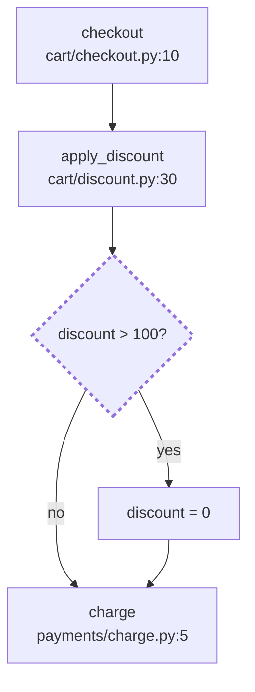

# code-schematic

Shows how one code path works at one git ref: a high-level picture plus the code that makes it. One call writes
one file for one ref. To compare two states, call it twice (section 5).

## 1. Inputs

| Input | Meaning | Default |
|---|---|---|
| `ref` | a sha, branch or tag, or `WORKTREE` for uncommitted files | `HEAD` |
| `label` | `Before`, `After` or none | none |
| entry point | the function, command or file where the path starts | ask; never guess |
| scope | where to stop following calls (a layer, a package, a boundary) | stop at the repo's edge |
| `diff` | a range such as `base..head`, to mark what changed | none |
| output path | where to write the file | `<label lowercased>-schematic.md`, or `schematic.md` without a label, in the caller's folder, else the current directory |

## 2. Read at the ref

Every line ref you write is read at `ref`: `git show <ref>:<path>`, never from the working tree. With
`ref = WORKTREE`, read the working-tree files and say so in the title. Resolve the ref's date with
`git log -1 --format=%cs <ref>` (today for `WORKTREE`). Trace the calls from the entry point, in order, until the
scope ends.

## 3. Output, in this order

1. **Title:** `# <label>: <entry point> at <short sha or "working tree">, <date>`, then one line:
   `Line refs point at <ref>.`
2. **`## High-level flow`:** a Mermaid `flowchart TD` of at most 15 nodes.
   - One node per function: `id["name<br/>path:line"]`.
   - Decisions are diamonds: `id{"condition?"}`, with the outcome on each edge.
   - Every outcome that ends the flow (return, error, exit, stop) is its own node.
   - With a `diff`, mark the touched nodes: `classDef changed stroke-width:3px,stroke-dasharray:4` and
     `class <ids> changed`.
   - More than 15 nodes: collapse one layer into a single node, and say which under the chart.
3. **`## Schematic`:** pseudo-code in the repo's language. The caller first, then one block per layer in call
   order. Each block opens with a file banner (`# ── path/to/file ──`), keeps the real names, and ends each line
   it summarises with `# :<line>`. With a `diff`, mark lines `# NEW` or `# CHANGED`; without one, no marks.
4. **`## Decision table`:** only when a gate has three or more inputs. One column per input, one row per case,
   the outcome last.

## 4. Example

````markdown
# After: checkout() at 1a2b3c4, 2026-11-20
Line refs point at 1a2b3c4.

## High-level flow


## Schematic
```python
# ── cart/checkout.py ──
def checkout(cart):                        # :10
    total = apply_discount(cart)           # :12
    charge(cart.user, total)               # :13

# ── cart/discount.py ──
def apply_discount(cart):                  # :30
    discount = cart.total * cart.coupon.rate  # :31
    if discount > 100:                     # :38  CHANGED
        discount = 0                       # :39
    return cart.total - discount           # :40

# ── payments/charge.py ──
def charge(user, amount):                  # :5
    gateway.capture(user.card, amount)     # :7
```

Not traced: `gateway.capture` (external payment library).
````

## 5. Comparing two states

Call it twice, for example `ref=<base> label=Before` and `ref=<head> label=After diff=<base>..<head>`. Keep the
same layer order, the same block banners and the same node ids in both files, so they read side by side. On the
second call, read the first file before tracing and reuse its layers, banners and node ids; add a layer only when
the new state has one, and add its banner to the first file too. A layer that exists in only one state still gets
its banner in both, with `# (absent at this ref)` in the other.

## 6. Close with what you did not trace

End the file with one line naming the calls you stopped at (scope edge, external libraries, dynamic dispatch you
could not resolve), so the reader knows where the picture stops.
